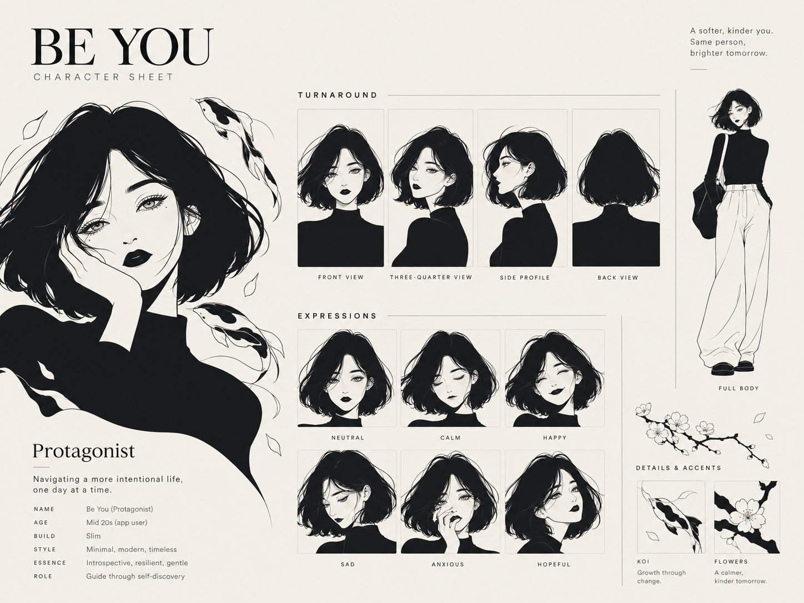
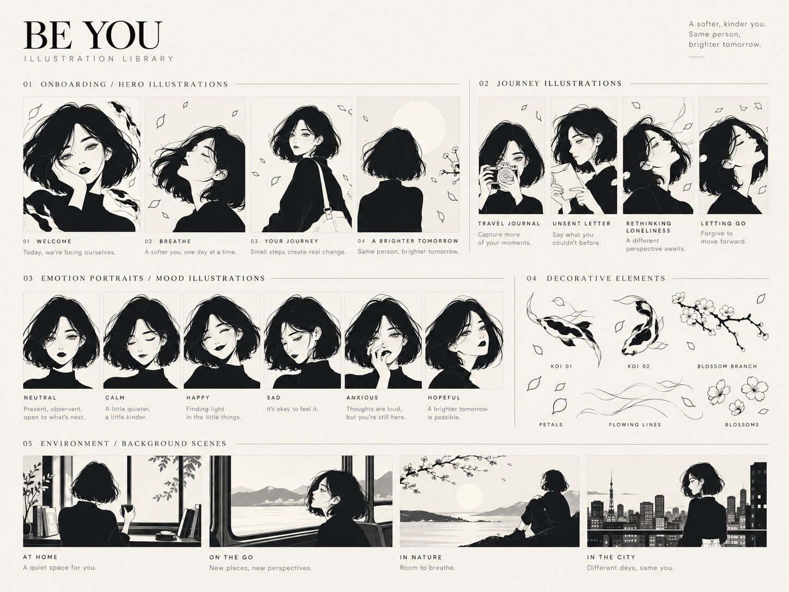
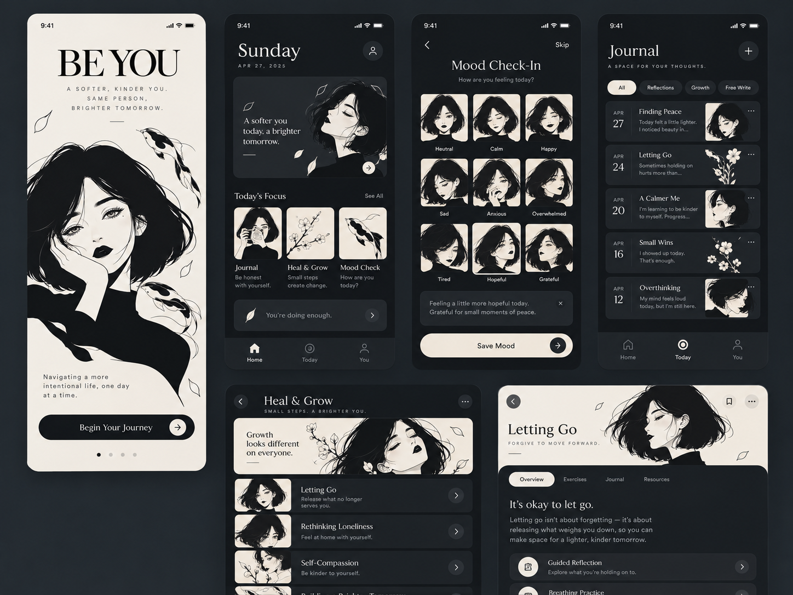
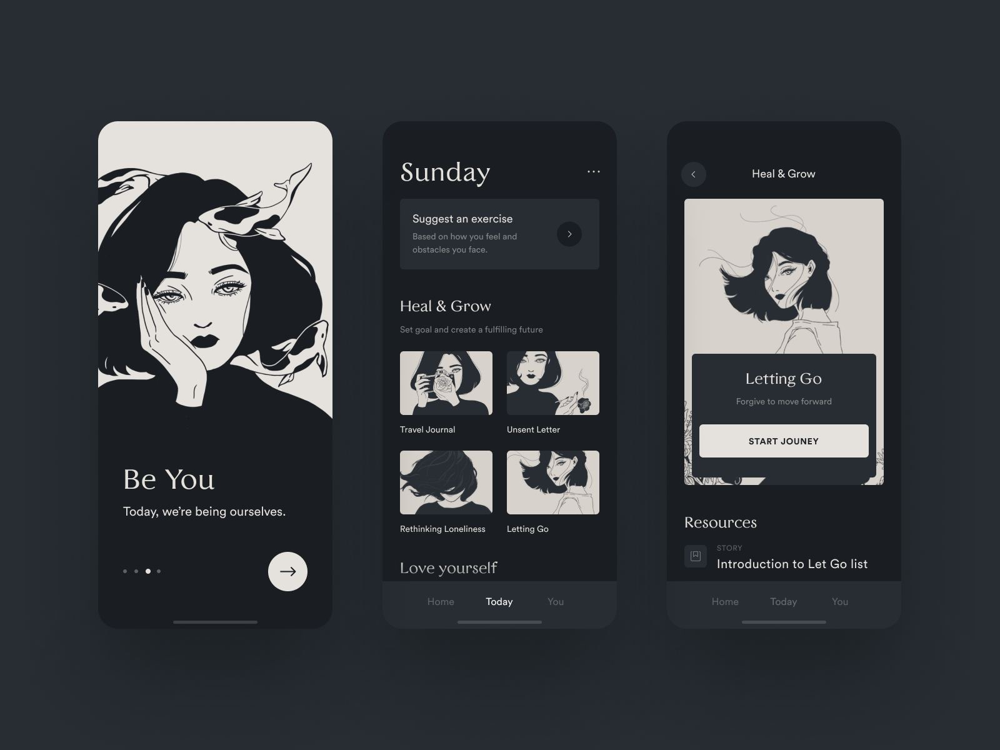

# BE YOU — Visual Design References

**Status:** Approved visual direction · October 2026

This private repository collects the approved visual direction for **BE YOU**, a self-reflection and mood-tracking Progressive Web App. The aesthetic is **minimal editorial manga**: confident black silhouettes, warm ivory negative space, delicate facial linework, and a calm charcoal interface.

## Approved references

### Character and expression sheet

### Illustration library

### Revised app screens

## Original inspiration

See [the style guide](docs/STYLE_GUIDE.md), [asset inventory](docs/ASSET_INVENTORY.md), and [production notes](docs/PRODUCTION_NOTES.md) for implementation guidance.

The three approved images are **visual concept boards**, not separate production-ready artwork. The original inspiration photo is for art direction, not a source to copy or redistribute as application artwork.

**Keep this repository private** until asset rights and publication plans have been reviewed.
