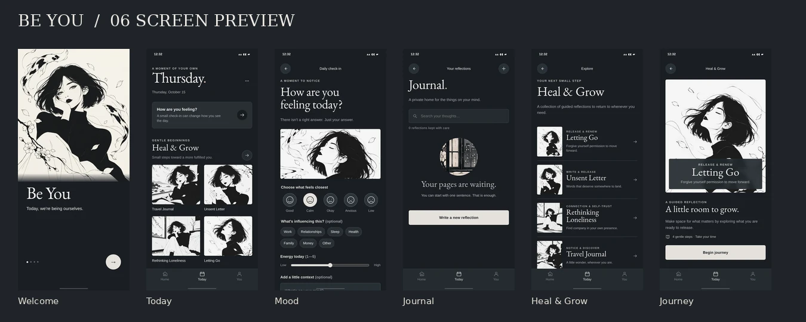
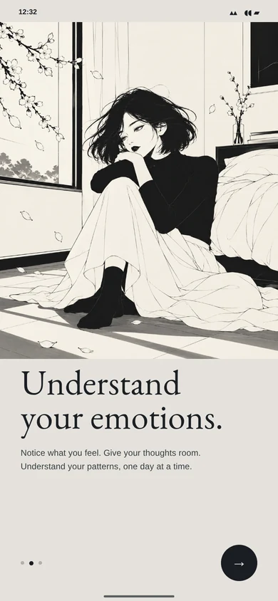
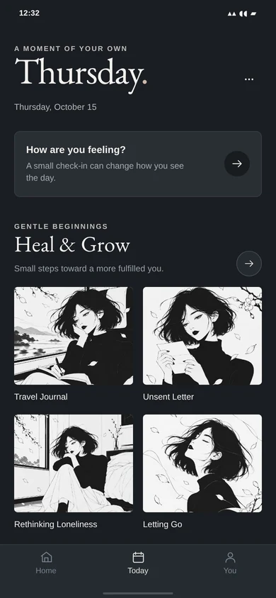
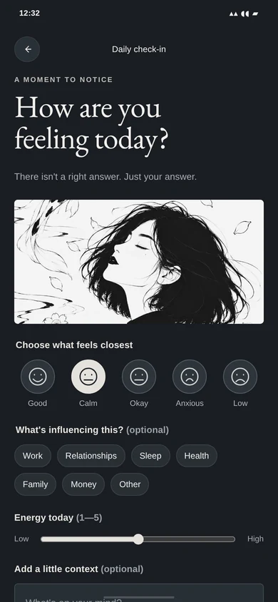
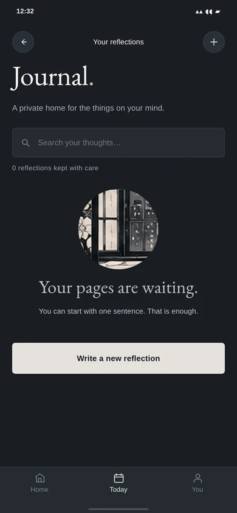
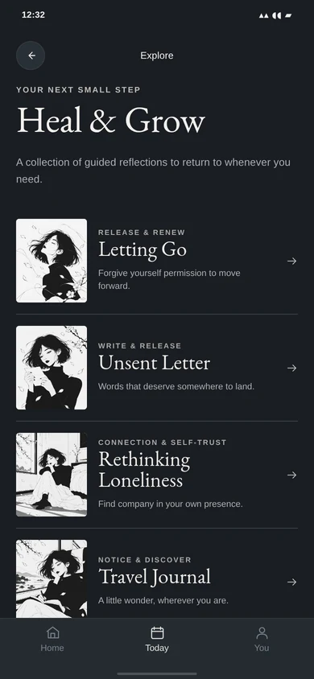
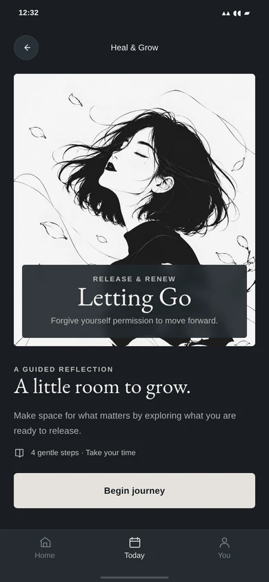
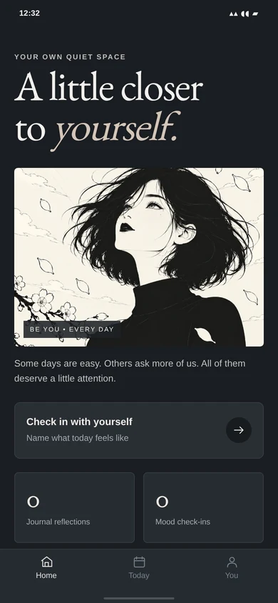
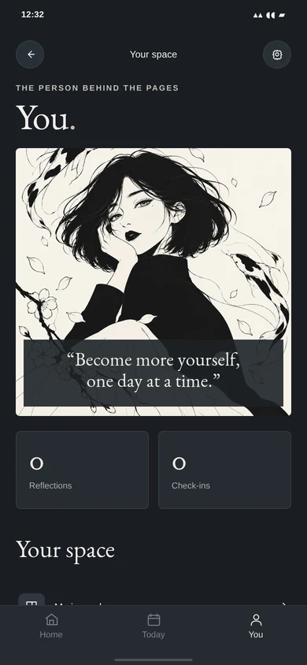

# BE YOU

**A private, manga-illustrated space to notice, reflect, heal and grow.**

[](docs/previews/SCREEN_GALLERY.webp)

**Status:** working local-first PWA prototype · **Art direction:** approved minimal black-and-ivory editorial manga · **Last visual review:** 15 October 2026.

> **Start here:** The app lives in [`app/`](app/). The previous `pwa/` copy has been consolidated. The approved images live in [`assets/illustrations/`](assets/illustrations/), and visual direction lives in [`references/approved/`](references/approved/). This is an actively developed prototype, **not** a clinical service or production deployment.

## Screen gallery — real UI captures

These are **screenshots from the implemented mobile interface**, not AI-generated phone mockups. Click any image to enlarge it.

| Welcome | Onboarding | Today |
|:--:|:--:|:--:|
| [](docs/previews/screens/welcome.webp) | [](docs/previews/screens/onboarding.webp) | [](docs/previews/screens/today.webp) |
| **Mood Check-in** | **Journal** | **Heal & Grow** |
| [](docs/previews/screens/mood-check-in.webp) | [](docs/previews/screens/journal.webp) | [](docs/previews/screens/heal-and-grow.webp) |
| **Journey detail** | **Home** | **Your profile** |
| [](docs/previews/screens/journey-detail.webp) | [](docs/previews/screens/home.webp) | [](docs/previews/screens/profile.webp) |

More views: [Phase 01 contact sheet](app/screenshots/PHASE_01_CONTACT_SHEET.jpg) · [UI-to-mockup review](docs/UI_PARITY.md).

## Approved design references

The **reference boards are creative direction**, whereas the gallery above shows the actual implemented UI. They must not be confused with export-ready individual artwork.

| Character & expressions | Illustration vocabulary | App screen concept |
|:--:|:--:|:--:|
| [](references/approved/01-character-sheet.png) | [](references/approved/02-illustration-library.png) | [](references/approved/03-updated-app-screens.png) |

[Original reference image](references/inspiration/00-original-visual-reference.jpg) · [Style guide](docs/STYLE_GUIDE.md) · [Approved standalone assets, Vol. 01](assets/illustrations/volume-01/) · [Vol. 02](assets/illustrations/volume-02/).

**Design contract:** near-black charcoal surfaces; warm ivory art panels; refined serif headings and unobtrusive sans-serif controls; graphic black ink with expressive, restrained manga linework; quiet spacing; minimal three-tab navigation. Original artwork is treated as a standalone asset, never a screenshot background. See [UI parity & intentional differences](docs/UI_PARITY.md).

## Run the application

Requires **Node.js 18+**. No npm install or third-party runtime dependencies.

```bash
cd app
npm start
```

Visit **http://localhost:4173**. For visual review, use `?screen=welcome`, `?screen=today`, `?screen=mood`, `?screen=journal`, `?screen=heal`, or `?screen=journey-detail`.

```bash
cd app
npm test
```

`npm test` checks project files, screen destinations, image references, PWA manifest and precache paths. It does **not** replace browser/device accessibility and offline QA.

### Currently implemented

- Mobile onboarding, Today/Home/You navigation and 4 guided, saved-progress journeys.
- Real mood check-ins with tags, optional writing and energy; locally persisted.
- Journal create/edit/search/delete; insights based on **your own entries**, not invented statistics.
- Breathing timer, affirmation rotation/favourites, and appearance/accessibility preferences.
- Data export/import/delete; local-first PWA shell and cached images for offline use.

**Privacy:** writings and mood data are stored in this browser's unencrypted `localStorage`. Shared devices, browser data clearing and missing backups pose real risks. There is no account, sync, or medical diagnosis. Export your data routinely. [Limitations and production checklist](docs/ROADMAP.md).

## Repository map

```text
Be-you/
├── README.md                      ← this visual project homepage
├── app/                           ← single runnable PWA source (no duplicate app)
│   ├── index.html
│   ├── styles.css, app.css
│   ├── ui-primitives.js, functional.js
│   ├── assets/approved/           ← 8 approved, local WebP runtime assets
│   ├── assets/manga/              ← documented fallback artwork (2 scenes)
│   ├── manifest.webmanifest, sw.js
│   ├── scripts/verify.mjs
│   └── docs/
├── assets/illustrations/
│   ├── volume-01/                 ← approved individual masters (4)
│   └── volume-02/                 ← approved individual masters (4)
├── references/
│   ├── approved/                  ← character, illustration and UI reference boards
│   └── inspiration/               ← original reference (design guidance only)
├── docs/
│   ├── previews/                  ← readable real-screen gallery for README
│   ├── UI_PARITY.md               ← screen-by-screen reference comparison
│   ├── REPOSITORY_GUIDE.md        ← where new work belongs
│   ├── ROADMAP.md                 ← what's not launch-ready
│   └── STYLE_GUIDE.md
└── pwa/README.md                  ← redirect for anyone following old links
```

**Single source of truth:** Edit `app/`. Add approved art masters to `assets/illustrations/volume-XX/`, then copy optimized production variants into `app/assets/approved/`. Update `APPROVED_ART` in `app/ui-primitives.js` and the service worker cache list. Don't add a second app folder. See [repository conventions](docs/REPOSITORY_GUIDE.md).

## Next milestone

Phase 01 integrates the eight approved standalone images and preserves working behaviour. Next: approve the revised UI gallery, complete more diverse *independent* art assets (environment-only scenes, poses and decorative motifs), then run full device, privacy, accessibility and installation QA before deployment.

[Contributing / asset checklist](CONTRIBUTING.md) · [Asset inventory](docs/ASSET_INVENTORY.md) · [Production notes](docs/PRODUCTION_NOTES.md)