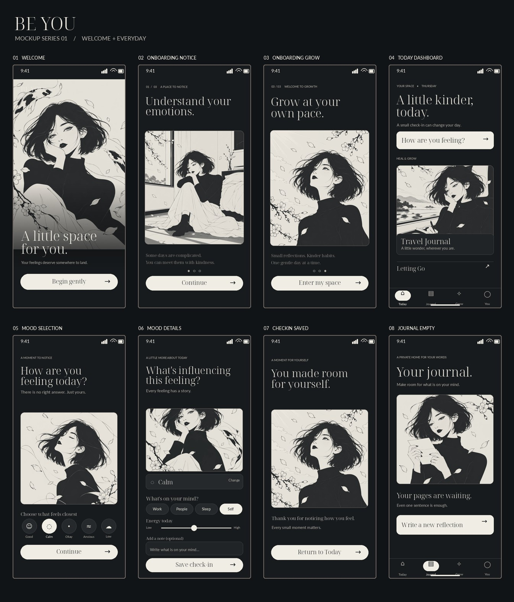
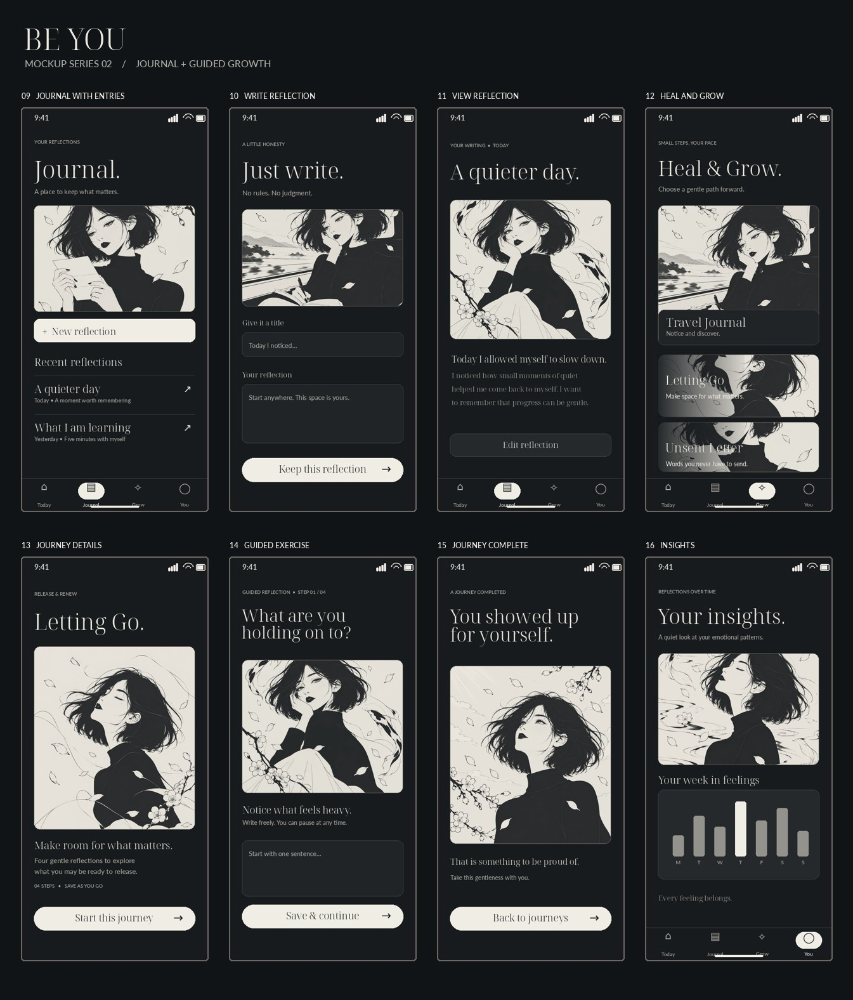
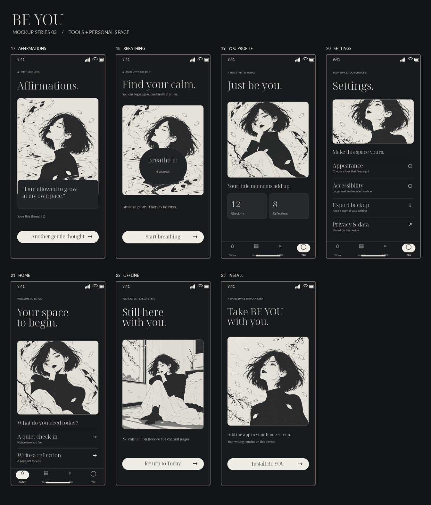
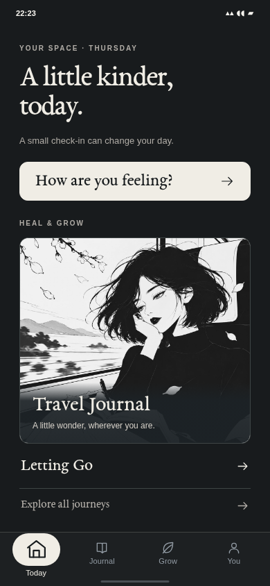
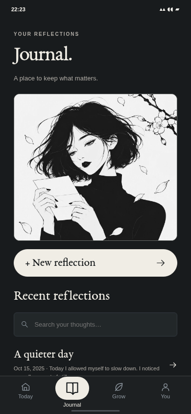
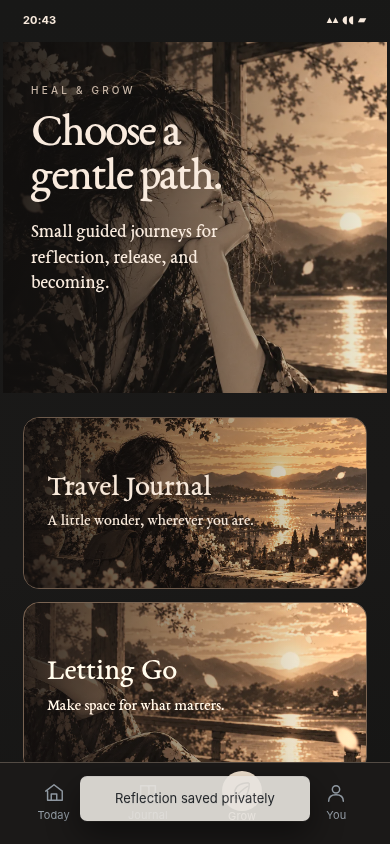

# BE YOU

**A beautifully illustrated, local-first wellbeing journal.** Track moods, write privately, and explore guided reflection journeys in a minimalist black-and-ivory manga interface.

> **One application. One approved reference library.** The current runnable app is in [`app/`](app/). Approved image boards and original visual inspiration are in [`references/`](references/). There are no parallel app implementations, experimental art folders, or separate design-preview directories.

## APPROVED DESIGN BASELINE — 23 screens

The complete **23-screen BE YOU mockup collection** was approved for implementation on 2026-10-16. It is the authoritative UI reference for the existing PWA: original black-and-ivory manga illustrations, oversized art-led surfaces, spacious serif typography, quiet rounded controls and four bottom mobile tabs. **These are visual concepts**; the real working screens are implemented in [`app/`](app/).

| 01 · Welcome, Today & Mood | 02 · Journal & Growth | 03 · Tools & You |
|:--:|:--:|:--:|
|  |  |  |

**[Browse all 23 individual approved screens](references/approved/mockups-2026-10-15/README.md)** · [Read visual specification](references/approved/mockups-2026-10-15/DESIGN.md) · [View actual running UI capture](app/SCREENSHOT.png)

**Mood selector update (2026-10-16):** Screen 05 remains **one interactive screen**, not five pages. Tapping Good, Calm, Okay, Anxious or Low instantly changes the active rounded card, its restrained accent and supporting copy. The displayed portrait remains the original approved image for all five states; the recently proposed character faces were **not** added. See [mood decision](app/docs/MOOD_SELECTOR_2026-10-16.md).

The concepts guide a **single real application**. Images are not embedded as fake UI; check-ins, entries, choices and navigation remain interactive and private to the device. The eight original approved illustrations are reused throughout—no new faces or conflicting art libraries.

## Live application

**[Open BE YOU](https://itsnotalwin.github.io/Be-you/)** · [App source](app/) · [Latest implementation note](app/DESIGN.md)

The app is installed from one folder, `app/`, and deployed by GitHub Actions. Browser data stays locally, unencrypted and not automatically synchronized. Export backups from Settings.

## Real local UI evidence

| Today (390×844) | Journal (390×844) | Grow (390×844) |
|:--:|:--:|:--:|
|  |  |  |

The images above are captures of the running app in a local Chromium browser, not static design mockups. Older `app/screenshots/refined/` images remain historical. Production pages and physical-device validation are independent quality gates.

## Features and safety

Onboarding, daily mood selection and optional notes, private journal with read/edit/search/delete, four reflection journeys with progress, insights, affirmations, guided breathing, PWA installation/offline, appearance and accessibility settings, export/import. The data is stored **unencrypted in browser localStorage**, without account sync; important writing should be backed up, and shared devices avoided. This is not medical care.

## Development and deployment

Requires Node.js 18+. `cd app && npm start` opens `http://localhost:4173`; `cd app && npm test` checks source integrity and flows. GitHub Actions verifies and deploys the `app/` folder to [GitHub Pages](https://itsnotalwin.github.io/Be-you/). View [deployment workflow](.github/workflows/deploy-pages.yml).

## Repository structure

- `app/`: only runnable PWA, eight approved art assets, test scripts, real UI screenshots.
- `references/approved/mockups-2026-10-15/`: approved 23-screen design references and overview boards, **not** a second app.
- `references/`: older approved artwork boards and original inspiration.

**Remaining production gates:** physical iOS/Android installation and layout checks, deployed Pages inspection, accessibility review, and security/privacy audit.