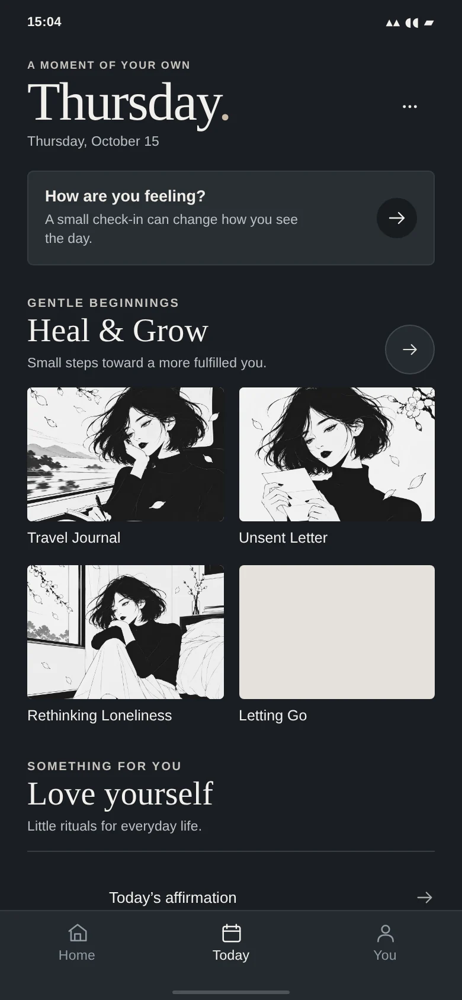
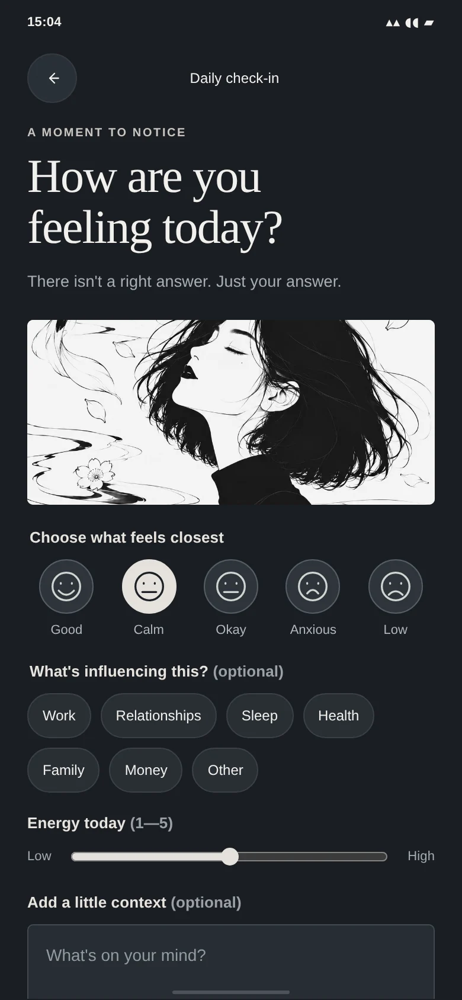
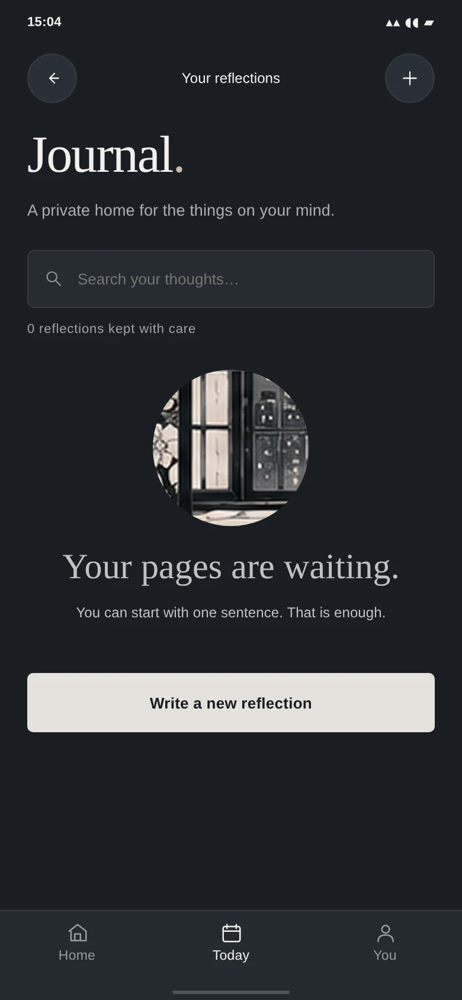
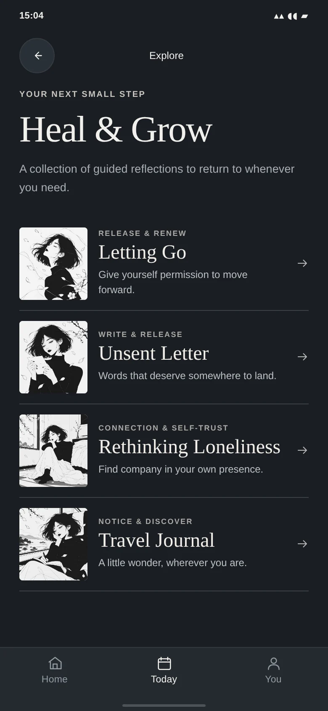
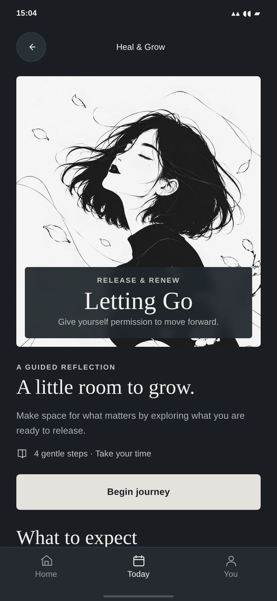
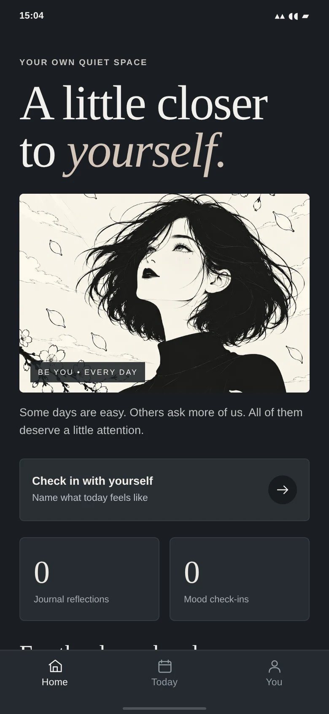
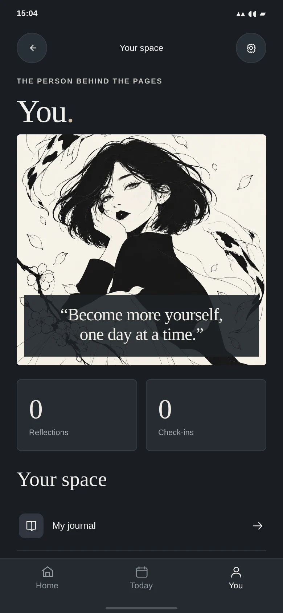
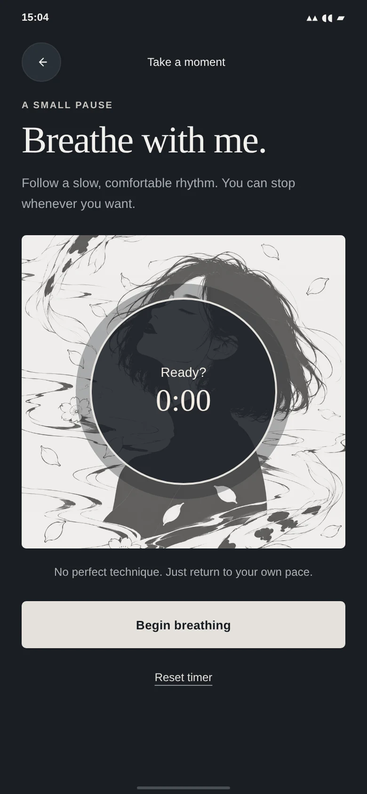

# BE YOU — Runnable PWA

[**Visual gallery, approved mockups, and repository guide →**](../README.md)

This is the **canonical implementation**. Run `npm start` and open <http://localhost:4173>. Node 18+; no installation or build step required.

Run `npm test` to verify the screen references, local artwork, web manifest and offline shell assets **and** smoke-check mood, journal and guided journey persistence with the actual runtime code. For manual smoke checks, review mood save, journal create/edit/delete, journey progress, settings/data export and PWA install/offline on localhost or HTTPS.

Entry files: `index.html`, **`app.css` (all app styling)**, `ui-primitives.js` (reusable icons/components and approved artwork routing), **`functional.js` (all actual screen templates, state and interactions)**, and `sw.js` (offline).

Eight approved standalone illustrations live under `assets/approved/volume-01/` and `volume-02/`. All runtime illustrations now come exclusively from the eight approved assets; no legacy concept images are loaded. Originals are in the root `assets/illustrations/` archive.

## Updated UI screenshots — complete 10-screen set

The screenshots below are the **approved UI refinement captures** from the preceding iteration (780 × 1688). The unified app retains their visual styles and artwork; the app’s screen templates now live only in `functional.js` and its CSS is merged into `app.css`. These captures have not been re-rendered after consolidation because browser navigation is blocked in the current QA environment. Open the running app for final visual sign-off.

| Welcome | Today | Mood check-in |
|:--:|:--:|:--:|
|  |  |  |
| Journal | Heal & Grow | Journey detail |
|  |  |  |
| Home | You | Breathing |
|  |  |  |

[Affirmations screenshot](screenshots/refined/affirmations.webp) · [Main project gallery](../docs/previews/UI_REFINEMENT_GALLERY.webp) · [Original design mockups](../references/approved/03-updated-app-screens.png)

All application source files, icons, approved WebP illustrations, and brand imagery live under `app/`. Older implementations are preserved in Git history rather than duplicated as competing app directories.

**Privacy warning:** Mood and journal data are stored in unencrypted browser localStorage. There is no login or sync; data can be lost when browser storage is cleared, and shared-device access is possible. Export backups from Settings. This is not medical care or an emergency-support service.

**Stage:** reviewed prototype, not production-ready. See [UI parity](../docs/UI_PARITY.md), [technical limitations](../docs/ROADMAP.md) and [asset integration notes](docs/PHASE_01_ART_INTEGRATION.md).

## Unified application (October 2026)

There is **one actual screen registry**, in `functional.js`. The old static mockup screens were removed from `ui-primitives.js`. All styling is in `app.css` and all in-app illustrations route to the eight approved WebP assets. The offline cache has been versioned to `be-you-v2-unified-app`. Existing locally saved data keeps the same storage key and format.

`npm test` now runs source validation and a zero-dependency VM smoke test of all real screen templates plus mood, journal, and guided journey flows. **Live browser, service-worker and accessibility checks are still outstanding**. See `../docs/UNIFIED_APP.md` for exact implementation decisions.