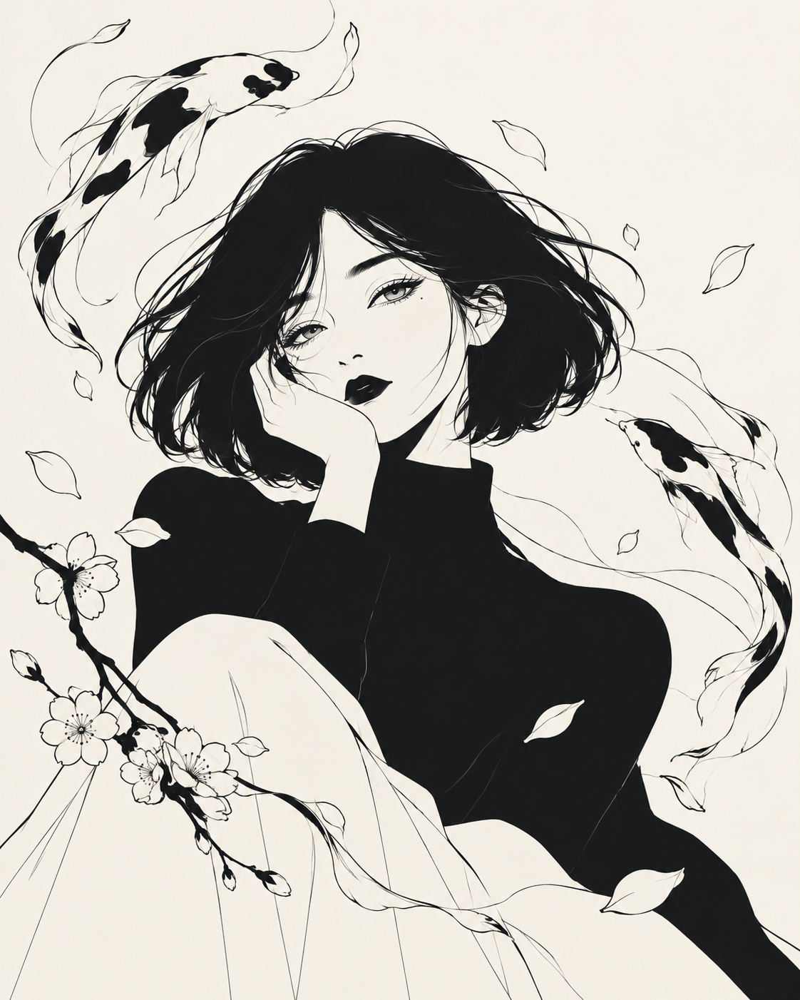
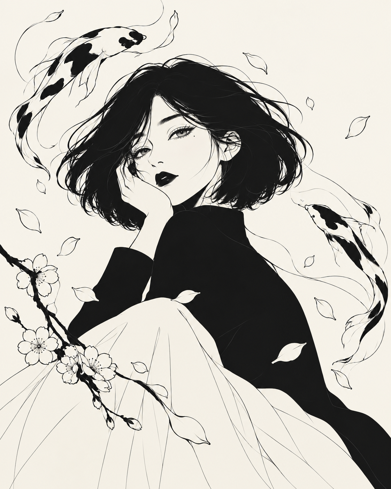
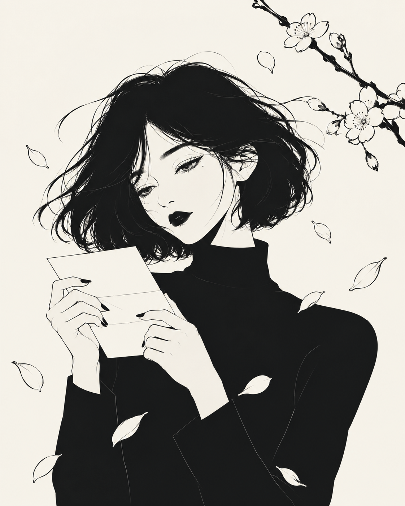
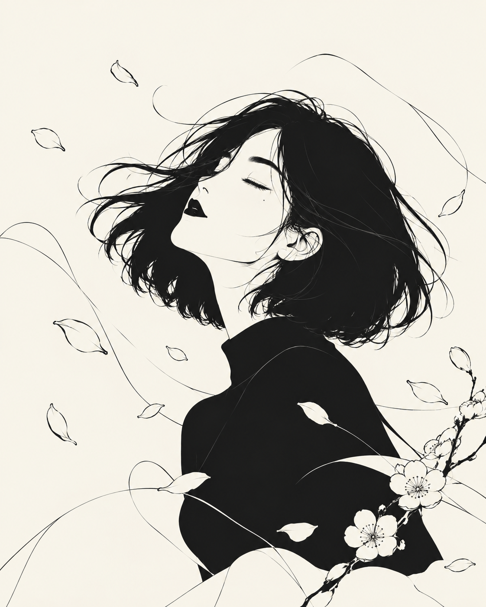

# BE YOU — Standalone Manga Illustrations (Batch 01)

These are **four original standalone PNG illustrations** for the approved minimal black-and-ivory editorial manga direction. Unlike the earlier concept boards, each file is a full individual image, not a crop from a multi-image collage.

All four originals are **1122 × 1402 px**, PNG with an ivory background. Preserve them as source masters; make optimized WebP/AVIF derivatives for the application. The character style is inspired by our approved character sheet but AI rendering can introduce small variations.

### 01. Koi and Sakura Portrait

- File: `contemplative_koi_and_sakura_portrait.png`
- Proposed use: onboarding, hero, splash
- SHA-256: `837003d571375a3e2b3479303aa1ab7f9a3fd264bfde7c3dfd2c36b93b215cf5`

### 02. Koi and Blossom Reverie

- File: `monochrome_koi_and_blossom_reverie.png`
- Proposed use: onboarding, hero, reflection
- SHA-256: `178e7253734ef2e048aaac2bab1c3e64eaf17202197831f82369de84aff1fdc7`

### 03. Unsent Letter — Under Blossoms

- File: `contemplative_letter_beneath_blossoms.png`
- Proposed use: journey, unsent-letter, journaling
- SHA-256: `99016e82250c1032daeb71718f02129293a5d407fe6e17b76e9aff82f5b99e92`

### 04. Letting Go — Windblown Blossoms

- File: `serene_windblown_blossom_portrait.png`
- Proposed use: journey, letting-go, breathing
- SHA-256: `09796a0f62ddb625d7acb45839fab65a324d50fffc235ea597e291a5fc6626ca`

Do not alter these master images directly; create optimized derivatives in a separate folder. Any newly generated character illustrations should follow the approved character and style references under `references/approved/`.
