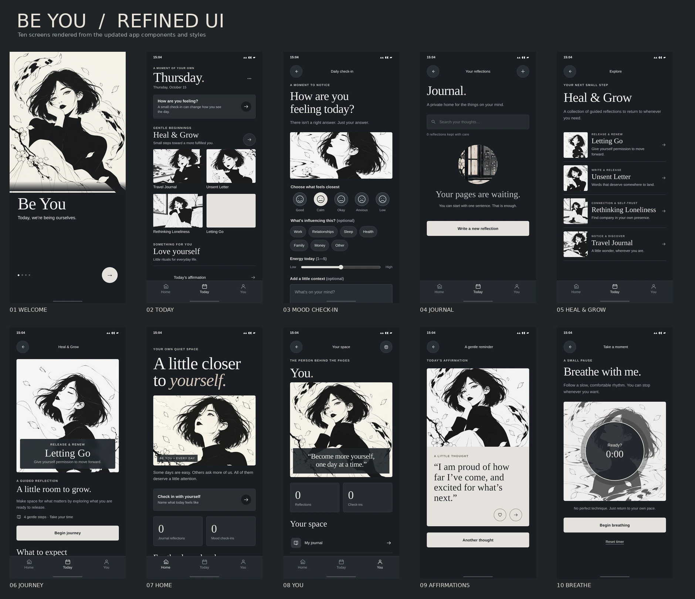

# BE YOU — UI Refinement Pass (October 2026)

**Reference:** [original three-screen inspiration](../references/inspiration/00-original-visual-reference.jpg), [approved concepts](../references/approved/03-updated-app-screens.png), and the [working PWA](../app/).

## Changes implemented

| UI surface | Refinement | Intent |
|---|---|---|
| Today | Reduced oversized weekday and excess vertical spacing; tightened prompt card and two-column art tiles | Original mockup hierarchy, four visible journeys |
| Journey art | Set subject-aware crops for travel, unsent letter, loneliness, letting go | Keep eyes and expression visible in card thumbnails |
| Heal & Grow | More compact list rows, quieter label, framed hero description | Editorial balance rather than generic dashboard cards |
| Mood | Adjusted image strip, spacing between choices, labels, and fields | Improve legibility without clutter |
| Journal | Improved excerpt and date contrast, field dimensions, focus borders | Comfortable sustained writing |
| Onboarding | Calibrated artwork height and heading scale | Preserve protagonist composition |
| Navigation | Harmonized fixed 3-tab bar, visible active state, added accessible navigation landmark and `aria-current=page` | Reliable touch and assistive-tech affordances |
| Everywhere | Refined typography, quiet charcoal/ivory colours, 44px+ small control targets and safe-area rules | Consistent app-wide components |

The changes are implemented as [`app/refinement.css`](../app/refinement.css) layered after the base design styles so the intent is easy to audit. Runtime artwork and data flow are unchanged. The service worker cache version was incremented and includes the new stylesheet.

## QA performed

- Project integrity `npm test` passes, checking local art, manifest, and offline cache.
- A Chromium **isolated DOM harness** loads the app's original templates, JS, embedded art files, and exact CSS (with URL/history and storage mocked solely because top-level navigation to HTTP/file is blocked by this environment). It rendered 40 screen/viewport combinations at widths **320 / 360 / 390 / 430 CSS px**; there were **zero missing images, JS errors, or document horizontal overflows**. This does not prove native-PWA installation or persistence under a real browser origin.
- Verified interactive journey-card routing, mood selection state, and check-in transitions in that harness.
- Captured 10 updated 390px screen renders in [`app/screenshots/refined/`](../app/screenshots/refined/) in the downloadable review archive; the repository tracks the compressed [review gallery](previews/UI_REFINEMENT_GALLERY.webp) and selected PNG-derived WebP previews.

## Remaining visual approval and QA

1. Compare the revised screen gallery with the original mockup on a physical phone, especially journey cropping and large text setting.
2. Run production-origin browser tests for offline installation, service workers, storage/export/import, and navigation/back buttons.
3. Test Android TalkBack and iOS VoiceOver, high contrast, reduced motion and dynamic type.
4. Replace remaining legacy secondary environment images with approved independent originals only when art direction is signed off.

**No pixel-perfect claim:** Original reference shows different copy and was designed for a different screen height; the working interface uses real content and actual user data.